<div align="center">


# Tanong402

> An AI tutor for Filipino students, built on agentic payments. ₱0.29 a question instead of ₱1,000+ a month. Every question is a real USDC micropayment on Stellar, paid automatically through x402, by the app or by any AI agent.


**Stellar Instawards · 30-day sprint**

**Docs:** [📋 PRD](docs/PRD.md) · [🏗️ Architecture](docs/ARCHITECTURE.md) · [🧰 Tech Stack](docs/TECH_STACK.md) · [📁 Monorepo](docs/MONOREPO.md) · [🗺️ Build Plan](docs/BUILD_PLAN.md) · [🎨 Design Prompt](docs/CLAUDE_DESIGN_PROMPT.md) · [📓 Phase Log](docs/PHASE_LOG.md) · [🏆 Evidence](docs/EVIDENCE.md)

</div>

---

> 🚧 **Status: core live on Stellar testnet.** Paid questions, agent payments and sponsored onboarding all settle on-chain ([proof](docs/PHASE_LOG.md#verified-on-testnet)). **Next (Instawards sprint):** iPhone app, earn-to-learn quizzes and streaks, mainnet launch. See [Roadmap](#-roadmap-30-day-instawards-sprint).
>
> **Reward pool contract (testnet):** [`CAVZVSTO…7SCD`](https://stellar.expert/explorer/testnet/contract/CAVZVSTO55EMWLAQGG45B6HFOUPGB4LLIDX3HMW3BCG2QHR3FDMF7SCD)

## 🧩 Problem
AI tutors are priced for people with credit cards and ₱1,000+/month to spare. A Filipino student who needs help with three algebra problems the night before an exam cannot justify a monthly subscription, and has no way to pay for "just this one question."

## 🌟 Solution
Pay per question, in centavos, with payments handled by software instead of people. The student types a question, the app's built-in wallet pays ~$0.005 USDC (≈ ₱0.29) on Stellar through the x402 protocol, and the tutor answers step by step in English or Taglish. No subscription, no card, no seed phrase, and the word "crypto" never shows up in the UI. Students see a peso balance and "questions left."

**Agentic payments.** `POST /ask` is a standard x402 endpoint. Any AI agent with a Stellar wallet can pay per question the same way the app does, with no API key and no signup. [`examples/agent-cli`](examples/agent-cli) is an agent that pays for its own questions on testnet today.

**Earn to learn (building now).** Students earn free questions by studying: a Daily Challenge quiz, a 60-second Speed Round, daily streaks and optional rewarded ads. Get a quiz question wrong and "Explain this" opens the tutor on that exact question. Points aren't crypto and can't be cashed out, but every question they pay for is still a real x402 payment on Stellar with a public receipt.

## 💼 Business model

**We sell answers, one at a time.** Every question costs **$0.005 USDC (≈ ₱0.29)**, paid on Stellar through x402. There's no subscription and no card. A student who asks 100 questions in a month pays **₱29**, compared with **₱1,100+** for a monthly AI plan.

### Who pays
| Payer | How | Why they pay |
| --- | --- | --- |
| **Students** | Per question, from their balance or with points earned from quizzes and streaks | Help exactly when they need it (the night before a quiz) without a monthly bill |
| **Advertisers** | Optional rewarded ads, verified server-side. Ad revenue is deposited into the on-chain reward pool that pays for point-funded questions | Reach students at the moment they're studying |
| **AI agents and developers** | Pay `POST /ask` per call over x402 with their own wallet. No API key, no signup | A tutoring API they can call as a tool and pay for automatically |
| **Sponsors**: schools, orgs, brands | Top up the reward pool for their students | Fund learning, not a vendor. Every peso is traceable on `/proof` and Stellar Expert |

Everyone pays the same per-question price, and money becomes revenue only when a question is actually asked.

### Unit economics (measured on testnet, Oct 2026)
| Per question | Amount | Notes |
| --- | --- | --- |
| **Price** | **$0.0050** | `PRICE_USDC`, the same for every model in the menu |
| AI cost (Gemini Flash Lite) | $0.0004–0.0006 | 1.5–2 s |
| AI cost (GPT-5 nano / mini) | $0.0001–0.0014 | Auto-routing sends easy questions to the cheapest model |
| Network fee | $0 to us | The x402 facilitator sponsors settlement fees |
| **Gross margin** | **≈ 72–97%** | Worst case is a hard question on GPT-5 mini |

Per-student setup (paid by the treasury, one time):
- **1.5 XLM** reserve for the account and its USDC trustline. This is a sponsored reserve: it stays locked while the account exists and comes back if the account is closed.
- About **0.002 XLM** in fees per relayed pool claim.

Each answer's real AI cost is logged as `cost_usd`, so margin is tracked per question, not estimated.

### Pricing tiers
A single flat price can't cover premium models. A normal Claude Sonnet answer costs us about $0.008, more than the whole $0.005 price. So premium models get their own price, and x402 handles that: the 402 reply tells the wallet the exact price **before** the student pays, and the server can set it per request from the model picked.

| Tier | Models | Our cost per answer | Price | Status |
| --- | --- | --- | --- | --- |
| **Standard** | GPT-5 nano/mini, Gemini Flash Lite, Groq (Llama / GPT-OSS) | $0.0001–0.0014 (measured) | **₱0.29** ($0.005) | Live on testnet |
| **Pro** | GPT-5.4 (Claude Sonnet when its key is set; Gemini Pro opt-in) | **$0.0095–0.0107** (measured, GPT-5.4) | **₱1.16** ($0.02) | Live on testnet |

<p align="center">
  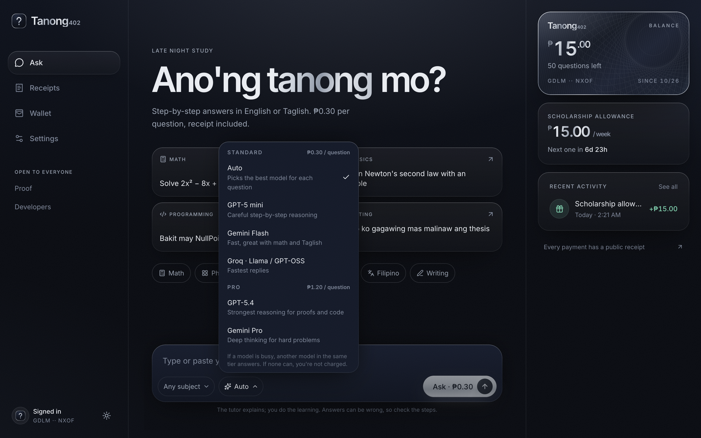
  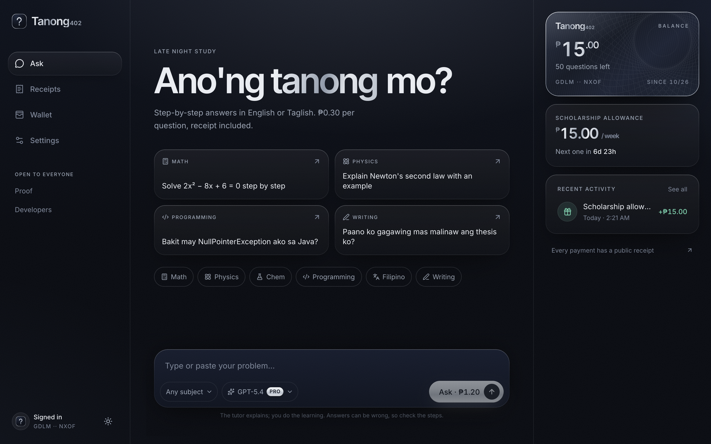
</p>

How it works: Pro questions go to `POST /ask?tier=pro`. The x402 paywall prices them from the query **before** reading the body, so the 402 asks for 200,000 units ($0.02). The API then checks that the model in the body matches the tier that was paid, and refuses a mismatch before answering, so it never settles. Pro answers use one length cap (`PRO_MAX_OUTPUT_TOKENS`, default 900) and low reasoning.

Measured on testnet (Oct 29, 2026), three paid Pro questions:

| Model | Question | AI cost | Margin at $0.02 |
| --- | --- | --- | --- |
| GPT-5.4 | Proof of d/dx xⁿ by limits | $0.0107 | ~47% |
| GPT-5.4 | Taglish: why merge sort is O(n log n) | $0.0095 | ~53% |
| Gemini Pro | Proof of d/dx xⁿ by limits | $0.0210 | **−5% (loss)** |

Gemini Pro's lowest thinking level still costs about $0.019–0.021 on a hard question, so it is **off by default**. Set `GEMINI_MODEL_PRO` to turn it on, or raise `PRO_PRICE_USDC`. At startup the API also warns if any Pro model's theoretical worst case exceeds the Pro price. With a maximum-length question, full history and every thinking token, that's about $0.04, which is rare in practice.

Two rules make tiers safe:
1. **Price is fixed before the answer exists.** The student signs an exact amount, so every tier has a hard cap on answer length. Worst-case cost is known, and the price covers it about twice over.
2. **Backups stay in the same tier.** A signed payment can't be lowered afterward, so a Pro question falls back only to other Pro models. If all of them fail, the student isn't charged, as today.

### Why Tanong402 instead of a subscription or your own API key
| | ChatGPT / Claude subscription | Your own API key | **Tanong402** |
| --- | --- | --- | --- |
| Cost | ₱1,100+/month, fixed | Cheapest per answer (~₱0.01–0.08) | ₱0.29 Standard · ~₱1.16 Pro |
| Needs a credit card | Yes | Yes, plus a $5–10 prepay | **No.** Pay in centavos, or a sponsor pays |
| Setup | Easy | Developer work: keys, code, billing limits | Open the app |
| Tutor behavior | Generic chat | None unless you build it | Step-by-step, Taglish, won't do graded work |
| Surprise-bill risk | None | **Yes** (leaked key, runaway loop) | None: exact price shown before every question |
| Free questions | Rate-limited free tier | No | **Yes**: earn them with quizzes and streaks |
| Usable by AI agents | No | Only your own | Yes: pay per call over x402, no signup |

**Who each option suits:**
- **Heavy daily users: a subscription.** ₱1,100 ÷ ₱0.29 ≈ **3,800 Standard questions a month**, about 125 a day. Above that a subscription is cheaper, and those users aren't our market.
- **Developers: their own API key.** Cheaper per answer, but it needs a card, code and care.
- **Most students: Tanong402.** They study in bursts, ask about **20–200 questions a month (₱6–58 with us)**, often have no credit card, and can earn questions by studying.

**Our edge isn't reselling models.** Anyone with an API key can undercut a pure reseller. The value is everything around the model:
- **agentic, no-card centavo payments**: software pays per question, never a human with a card
- **earn-to-learn**: free questions from quizzes and streaks, each still a real on-chain payment
- a **tutor built for Filipino students**
- an **API that agents can pay for automatically**

Pro tiers add occasional access to top models without a subscription. They don't replace that core.

### What it takes to break even
Running costs are mostly hosting: API server ~$7–20/month, while Vercel and Neon have free tiers.
- At about $0.004 margin per question, **~5,000 questions a month** covers hosting.
- **1,000 students × 40 questions a month** = 40,000 questions → **$200 revenue**, ~$15–55 in AI cost, **~$150 gross profit**.

### Growth levers
1. **Earn loop (building now).** Daily quizzes, streaks and a weekly school leaderboard bring students back every day, and every earned question is a paid question on-chain.
2. **Agent API.** The same `/ask` endpoint serves AI agents and study apps, paid per call. No sales process needed.
3. **iPhone app (building now).** On the home screen, with streak reminders and the wallet in the Keychain.
4. **Model menu + Pro tier (live).** Students pick a model in the chat. Auto (the default) keeps cost low, and Pro (₱1.16) adds top models per question.
5. **Peso top-up (next).** GCash/Maya → USDC through an anchor/onramp partner, so students can pay with their own pesos.
6. **School partners (later).** Schools and brands top up the reward pool for their students and see usage by subject.

### Honest status
In the pilot, **the team funds the reward pool**, so student spending is largely our own money coming back to our receiving address. Every payment is a real on-chain settlement, but it isn't outside revenue yet. Real revenue starts with ad revenue, the first paying agent, an outside sponsor, or peso top-ups. Ad revenue per view is small (roughly one question), and `/proof` will show the real numbers. See [`docs/EVIDENCE.md`](docs/EVIDENCE.md).

## 🗺️ Roadmap: 30-day Instawards sprint
Already built (testnet): paid `/ask` over x402, the agent CLI, sponsored student accounts, the reward pool contract, the multi-model tutor and the web app.

1. **iPhone app on the App Store.** Capacitor build of the web app, wallet in the Keychain behind Face ID, push notifications for streaks, offline quizzes.
2. **Earn to learn.** Open sign-up with no invite code, 5 free questions to start, then Aral Points from the Daily Challenge, Speed Round, streaks and optional ads (10 points = 1 question). Anti-abuse: App Attest, server-checked answers, verified ad rewards, daily limits.
3. **Mainnet launch.** Contract, API and app on Stellar mainnet, spending limits and signing-rule tests, and a public `/proof` page with a Stellar Expert link for every money flow.

Full scope: [`docs/SOW_INSTAWARDS.md`](docs/SOW_INSTAWARDS.md).

## 🔄 How one question works
1. Student types a question → app sends `POST /ask`.
2. Server answers `402 Payment Required` with the price.
3. The student's in-browser wallet signs the USDC payment, and the app retries automatically.
4. A facilitator verifies and settles the payment on Stellar (~5 s).
5. Server calls Gemini and returns **answer + transaction hash**. The receipt links to Stellar Expert.

## 🛠️ Tech Stack (summary)
- **Monorepo:** pnpm workspaces + Turborepo
- **Web (`apps/web`):** React 19 + Vite + TypeScript + Tailwind v4, installable mobile-first PWA
- **API (`apps/api`):** Node 22 + Express + `@x402/express` + `@x402/stellar`
- **AI:** OpenAI GPT-5 nano/mini, Gemini Flash, Groq (Llama / GPT-OSS) and Claude Haiku behind one router with automatic fallback; students can pick a model in the chat
- **Payments:** x402 on Stellar, USDC, facilitator-sponsored fees
- **Contract (`contracts/tanong-pool`):** Soroban reward pool. Holds sponsor and ad-revenue funds and caps how much goes out each week
- **Data:** Neon Postgres + Drizzle ORM (no separate auth: identity = wallet address)
- **Hosting:** Vercel (web) + Render (api)

Full rationale: [docs/TECH_STACK.md](docs/TECH_STACK.md).

## 📁 Repo layout
```
apps/web        student PWA (chat, receipts, wallet)
apps/api        Express + x402 paywall on /ask
packages/       shared types · browser wallet · tutor prompt
contracts/      tanong-pool Soroban contract (Rust)
examples/       agent-cli: an AI agent paying /ask by itself
scripts/        Stellar setup (keys, trustlines, pilot credits)
docs/           PRD, architecture, plan, design prompt, evidence
UI/             design exports per screen (WEB / MOBILE)
```
Details: [docs/MONOREPO.md](docs/MONOREPO.md).

## 🚀 Run locally

Prereqs: Node ≥ 22, pnpm 10 (`corepack enable`). For contracts: Rust + `wasm32v1-none`, Stellar CLI 28.

```bash
pnpm install

# 1. Demo mode (no keys): free answers, canned tutor
pnpm --filter @tanong/api dev            # http://localhost:3001
pnpm --filter @tanong/web dev            # http://localhost:5180

# 2. Real testnet: generates keys, funds them, buys test USDC, writes gitignored .env files
pnpm --filter @tanong/scripts setup:testnet
pnpm --filter @tanong/api dev            # now with the x402 paywall on /ask
pnpm agent                               # an AI agent pays /ask by itself
pnpm --filter @tanong/scripts e2e        # invite → sponsored account → pool claim → paid question

# Add GEMINI_API_KEY to apps/api/.env for live answers; DATABASE_URL (Neon) for persistence.
```

Checks: `pnpm typecheck && pnpm test && pnpm contracts:test`

## 🧪 Testing & on-chain evidence

Everything below was run on **2026-10-28** against **Stellar testnet** with the real `@x402/express` paywall and the public `x402.org` facilitator. Click any image for full size; every transaction links to Stellar Expert.

### Automated tests: 40 passing
| Suite | Tests | What it proves |
| --- | --- | --- |
| `packages/shared` · `wallet` · `tutor` | 15 | Money math, encrypted device wallet + passphrase backup, challenge signing, tutor routing, provider fallback, model choice & academic-honesty guard |
| `apps/api` | 12 | Pro tier pricing & tier/model mismatch refusal, demo mode, input validation, wallet-signature login (incl. Freighter SEP-53), **real x402 middleware: 402 → pay → settle**, and **no settlement when the tutor fails** |
| `contracts/tanong-pool` | 13 | Funding, enrollment, weekly cooldown, pause, admin-only calls, relayed student auth, TTL bumps |

<p align="center">
  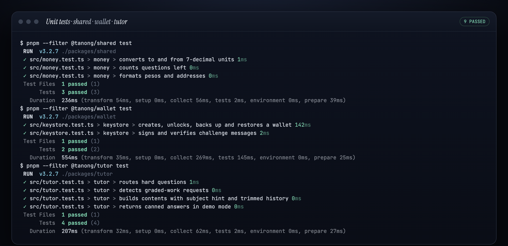
  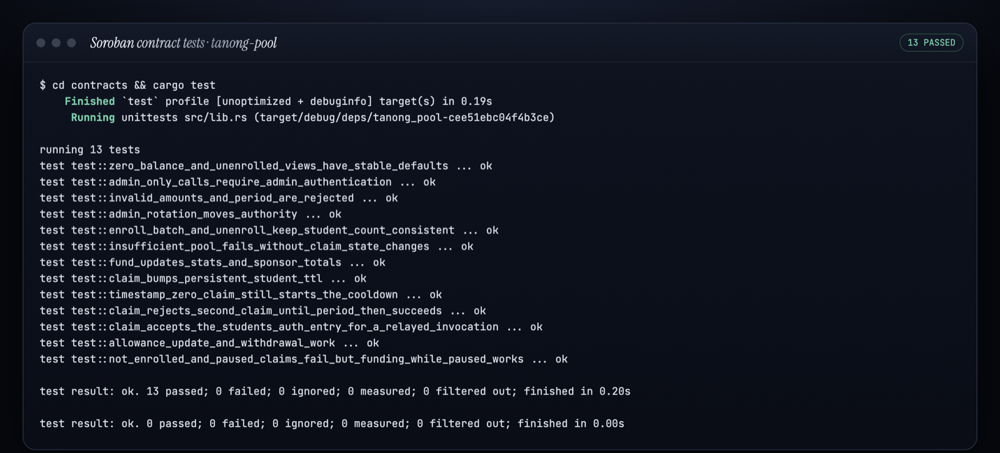
</p>
<p align="center">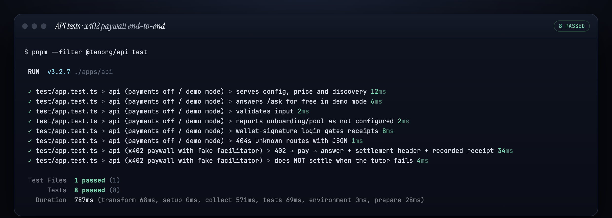</p>

### 1 · `/ask` answers `402 Payment Required`
Unpaid requests get an x402 v2 challenge: `exact` scheme, 50,000 units (0.005 USDC), USDC SAC, our receiving address.

<p align="center">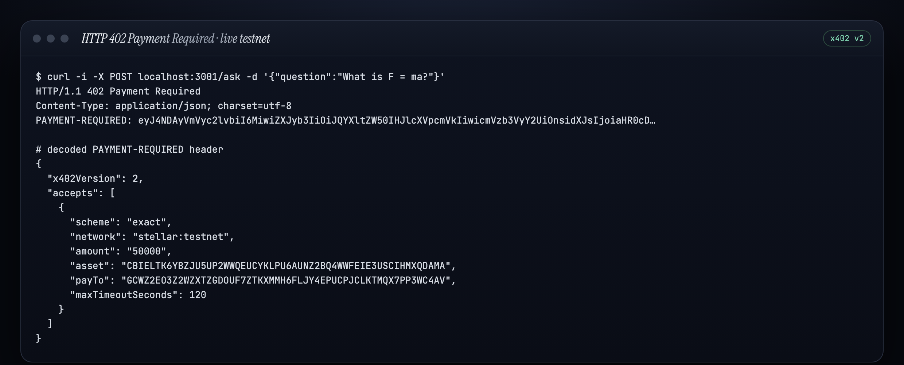</p>

### 2 · An AI agent pays per question by itself
`examples/agent-cli` holds its own key, enforces a spend policy, and pays three questions. The facilitator pays the network fee (fee-bump), and USDC moves agent → Tanong402.

<p align="center">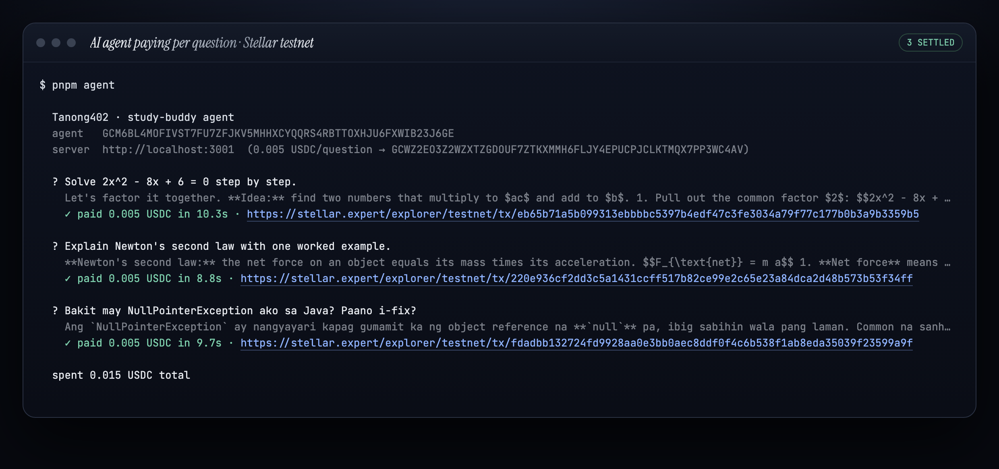</p>
<p align="center">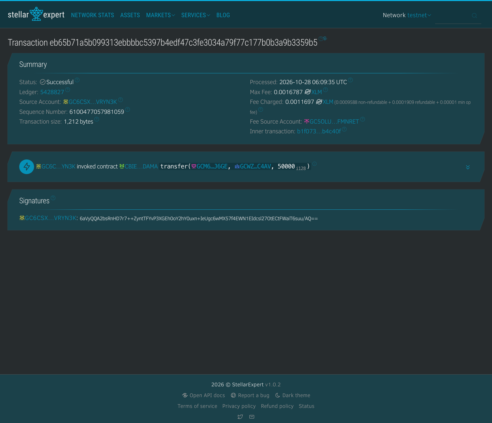</p>

> [`eb65b71a…59b5`](https://stellar.expert/explorer/testnet/tx/eb65b71a5b099313ebbbbc5397b4edf47c3fe3034a79f77c177b0b3a9b3359b5): `USDC.transfer(agent → Tanong402, 50000)`, fee source = facilitator.

### 3 · Full student journey: 0 XLM in their wallet
Invite code → treasury-sponsored account + USDC trustline → auto-enrolled in the reward pool → **relayed** weekly pool claim (student signs only the auth entry) → second claim refused → paid question.

<p align="center">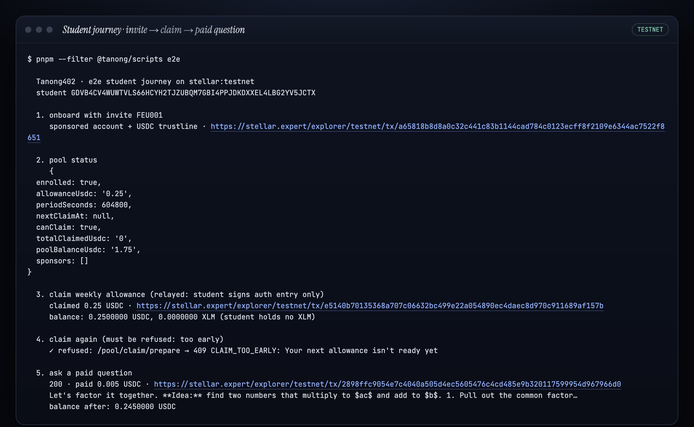</p>
<p align="center">
  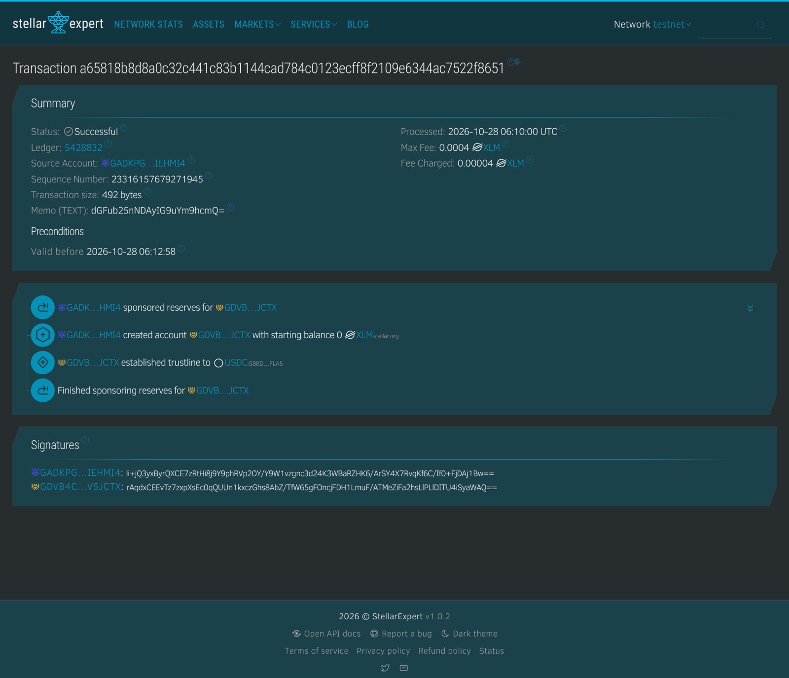
  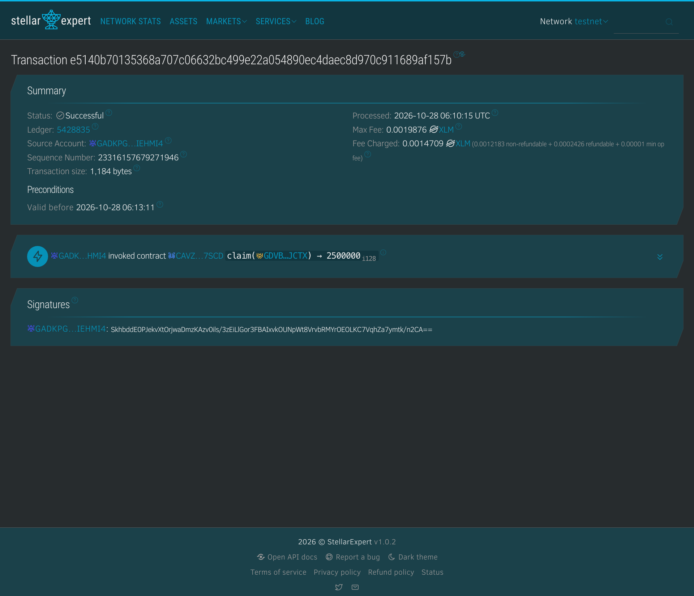
</p>

| Step | Transaction |
| --- | --- |
| Sponsored account + trustline (4 ops, treasury pays reserves) | [`a65818b8…8651`](https://stellar.expert/explorer/testnet/tx/a65818b8d8a0c32c441c83b1144cad784c0123ecff8f2109e6344ac7522f8651) |
| `claim(student) → 2500000` (0.25 USDC), submitted by treasury | [`e5140b70…157b`](https://stellar.expert/explorer/testnet/tx/e5140b70135368a707c06632bc499e22a054890ec4daec8d970c911689af157b) |
| Student's paid question (0.25 → 0.245 USDC) | [`2898ffc9…66d0`](https://stellar.expert/explorer/testnet/tx/2898ffc9054e7c4040a505d4ec5605476c4cd485e9b320117599954d967966d0) |

### 4 · Reward pool contract history
Constructor → `set_admin` → `fund(2 USDC)` → `enroll` ×4 → `claim` ×2, all visible on-chain.

<p align="center">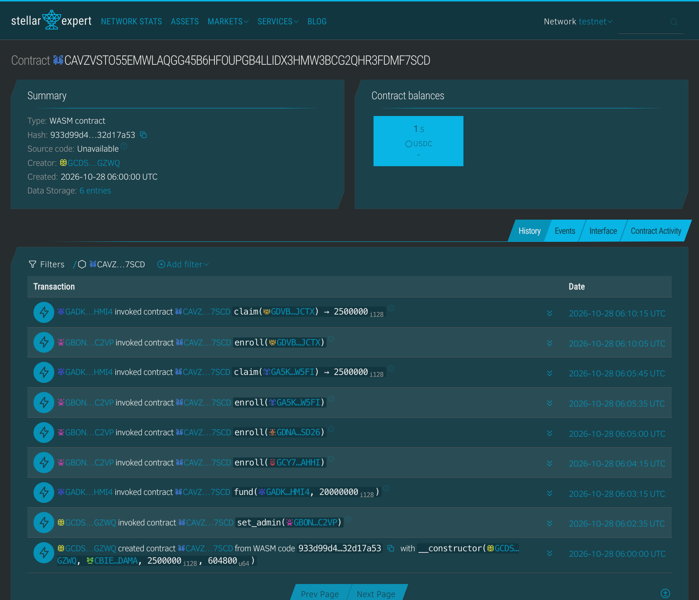</p>

### 5 · Live health + public stats
<p align="center">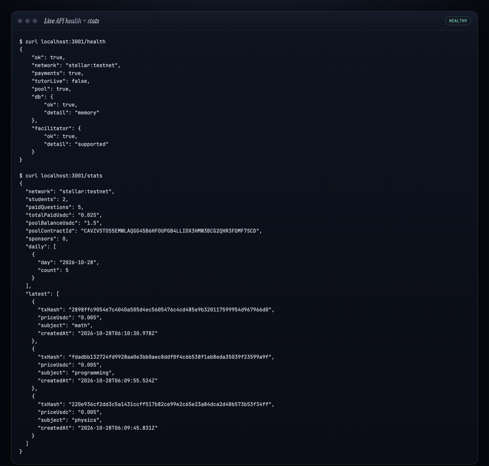</p>

More transaction hashes: [`docs/PHASE_LOG.md`](docs/PHASE_LOG.md#verified-on-testnet).

## 🏆 Evidence
Live demo, mainnet transaction links, and usage numbers are collected in [docs/EVIDENCE.md](docs/EVIDENCE.md).

## License
MIT
