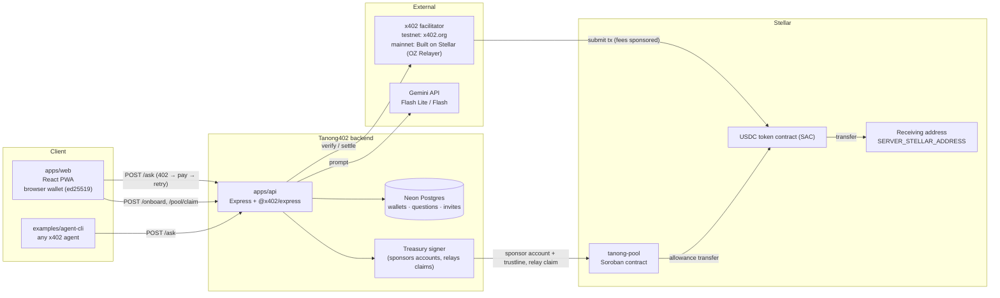
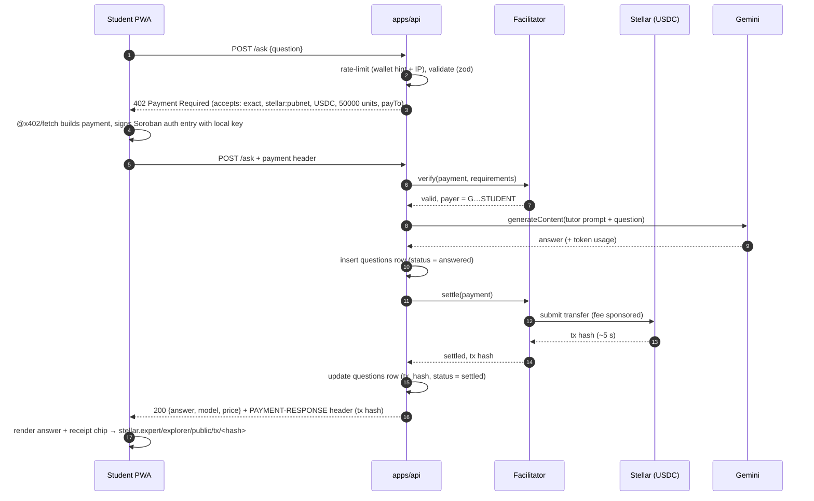
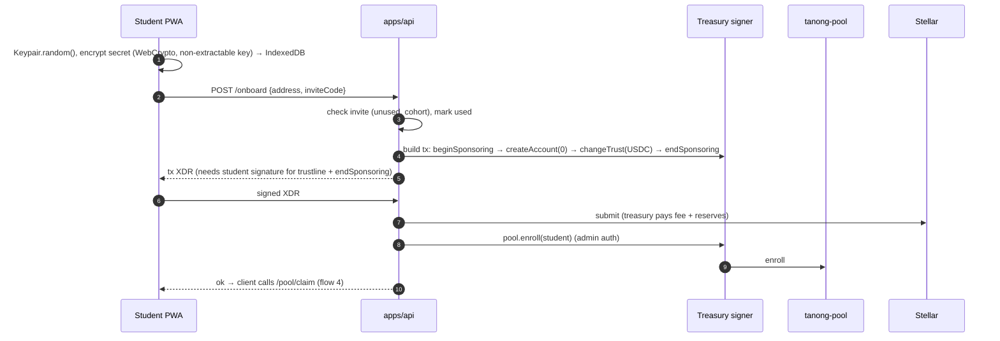

# Tanong402 — Architecture

Read with [PRD.md](PRD.md) (what and why) and [TECH_STACK.md](TECH_STACK.md) (which libraries).

---

## 1. System overview



**Three money flows, kept separate:**
1. **Per-question payment.** Student/agent → receiving address, via standard x402 `exact` on USDC. No custom contract, so any x402 client works.
2. **Allowance.** Pool contract → student, through `claim`. Gives students credit without an onramp.
3. **Funding.** Sponsor → pool contract, through `fund`. Public and auditable.

**Identity = Stellar address.** There's no separate auth service. The wallet address is the user ID. Private reads (history) use a short-lived JWT issued after the wallet signs a challenge.

---

## 2. Flow: one paid question



Rules:
- **Verify first, settle after success.** The `@x402/express` middleware verifies before our handler runs and settles only when the handler returns 2xx. If Gemini errors we return 5xx and the student is **not charged**. (Confirm this in the Phase 1 spike and note the result in PHASE_LOG.)
- **Tx hash.** The settlement result comes back in the `PAYMENT-RESPONSE` header. The client reads it from there, and the server copies it into the DB from a post-settle hook (like the official example's `paymentLogger` / `txHashInjector`).
- **Rate limit before payment**, so a limited request never gets charged.

## 3. Flow: onboarding (invite → first question)



## 4. Flow: claim allowance (relayed, student pays no fee)

1. PWA → `POST /pool/claim/prepare {address}`. The API builds an `invoke tanong-pool.claim(student)` tx with the **treasury as source** and simulates it to get the auth entry that needs the student's signature.
2. API returns the unsigned auth entry. The PWA signs it with the local key (`authorizeEntry`), same pattern as the x402 payment.
3. PWA → `POST /pool/claim/submit {signedAuth}`. The API attaches it, re-simulates, and the treasury signs and submits.
4. The pool transfers `allowance` USDC to the student. The API returns the tx hash and the balance updates.

The student account holds **0 XLM** of its own. Reserves are sponsored and fees are paid by the facilitator (x402) or treasury (claims).

---

## 5. Contract: `tanong-pool` (Soroban, Rust)

One instance per network. Holds USDC (via the USDC SAC address).

### Storage
| Key | Type | Scope |
| --- | --- | --- |
| `Admin` | `Address` | instance |
| `Token` | `Address` (USDC SAC) | instance |
| `Allowance` | `i128` (token units, 7 dp) | instance |
| `Period` | `u64` seconds | instance |
| `Paused` | `bool` | instance |
| `Stats` | `{ total_funded: i128, total_claimed: i128, students: u32 }` | instance |
| `Student(Address)` | `{ enrolled: bool, last_claim: u64, total_claimed: i128 }` | persistent (TTL bumped on claim) |
| `Sponsor(Address)` | `i128` total funded | persistent |

### Interface
| Fn | Auth | Behavior |
| --- | --- | --- |
| `__constructor(admin, token, allowance, period)` | — | set config |
| `fund(from, amount)` | `from` | transfer `amount` USDC from sponsor into pool; update `Sponsor`, `Stats`; event `funded` |
| `enroll(student)` / `enroll_batch(students)` | admin | mark enrolled; event `enrolled` |
| `unenroll(student)` | admin | disable future claims |
| `claim(student) -> i128` | `student` | require enrolled, not paused, `now ≥ last_claim + period`, pool balance ≥ allowance; transfer allowance; event `claimed` |
| `set_allowance(amount, period)` | admin | update config |
| `pause(bool)` | admin | stop claims (funding still allowed) |
| `withdraw(to, amount)` | admin | emergency / end-of-pilot recovery; event `withdrawn` |
| `set_admin(new)` | admin | rotate admin |
| views: `config()`, `stats()`, `student(addr)`, `next_claim_at(addr)`, `sponsor(addr)` | — | read-only |

### Tests (must pass before deploy)
Double claim in the same period fails · claim after period succeeds · non-enrolled fails · paused fails · insufficient pool fails cleanly · non-admin enroll/withdraw fails · `fund` updates stats · TTL bump on claim.

### Deployment
`scripts/contracts/deploy.sh <network>` → `stellar contract build`, `stellar contract deploy` with constructor args, and the contract ID written into PHASE_LOG + `.env` files. Testnet first; mainnet in Week 3.

> **Why no contract in the payment path?** If `payTo` or the asset were a custom contract, standard x402 facilitators and outside agents could not pay. Payments stay plain USDC transfers, and the contract handles funding and allowance around them.

---

## 6. Tutor and model routing

`packages/tutor` exports `buildTutorRequest(question, history, opts)` and `routeModel(question)`.

| Step | Detail |
| --- | --- |
| Input guard | Max 2,000 chars; strip control chars; reject empty |
| Router | Heuristic: long multi-step math/proofs/code → `GEMINI_MODEL_HARD` (Flash); else `GEMINI_MODEL` (Flash Lite). Logged for cost review |
| System prompt | Language matching, step-by-step, academic-honesty refusal, short default (see PRD §7) |
| Output cap | `maxOutputTokens` ≈ 600 (Flash Lite), 900 (Flash) |
| Context | Last 4 turns, max ~1,500 tokens |
| Output | Markdown with `$…$` math; client renders with KaTeX |
| QA set | `packages/tutor/qa/*.json`: 30 prompts (math, physics, programming, Taglish, cheating requests) run by `pnpm --filter tutor qa` |

---

## 7. API contract (`apps/api`)

| Method + path | Paid | Auth | Body → Response |
| --- | --- | --- | --- |
| `POST /ask` | **x402** | none (payer = identity) | `{question, history?, subject?}` → `{answer, model, priceUsdc, tokens}` + `PAYMENT-RESPONSE` header |
| `GET /price` | — | — | `{priceUsdc, pricePhp, asset, network, payTo}` |
| `GET /.well-known/x402` | — | — | x402 discovery doc (resources + description) |
| `GET /openapi.json` | — | — | OpenAPI 3.1 for agents |
| `POST /onboard` | — | invite code | `{address, inviteCode}` → `{xdr}`; then `POST /onboard/submit {signedXdr}` → `{txHash}` |
| `POST /pool/claim/prepare` | — | — | `{address}` → `{authEntry, nextClaimAt}` |
| `POST /pool/claim/submit` | — | signed auth | `{address, signedAuth}` → `{txHash, amount}` |
| `POST /auth/challenge` | — | — | `{address}` → `{nonce}` |
| `POST /auth/verify` | — | sig | `{address, signature}` → `{jwt}` (15 min) |
| `GET /receipts` | — | JWT | `?cursor` → `[{id, question, answerPreview, priceUsdc, txHash, createdAt}]` |
| `DELETE /receipts/:id` | — | JWT | delete stored text (tx stays on-chain) |
| `GET /stats` | — | — | public counts for `/proof` |
| `GET /health` | — | — | checks DB + facilitator `/supported` |

Errors: JSON `{error: {code, message}}`; codes `RATE_LIMITED`, `INVALID_INPUT`, `MODEL_ERROR`, `NOT_ENROLLED`, `CLAIM_TOO_EARLY`, `POOL_EMPTY`.

---

## 8. Data model (Neon Postgres, Drizzle)

```sql
wallets (
  address        text primary key,          -- G… public key
  kind           text not null,             -- 'student' | 'agent' | 'sponsor'
  cohort         text,                      -- e.g. 'feu-2026-11'
  invite_code    text,
  sponsored_tx   text,                      -- onboarding tx hash
  enrolled_at    timestamptz,
  created_at     timestamptz default now()
);

questions (
  id             uuid primary key default gen_random_uuid(),
  payer          text not null references wallets(address),  -- agents auto-inserted as kind='agent'
  question       text,                      -- nullable: deleted by user / retention
  answer         text,
  subject        text,
  model          text not null,
  tokens_in      int, tokens_out int,
  latency_ms     int,
  price_units    bigint not null,           -- 7 dp token units
  asset          text not null,             -- contract address
  network        text not null,             -- 'stellar:testnet' | 'stellar:pubnet'
  status         text not null,             -- 'answered' | 'settled' | 'settle_failed'
  tx_hash        text unique,
  created_at     timestamptz default now()
);
create index on questions (payer, created_at desc);

invites (
  code           text primary key,
  cohort         text not null,
  used_by        text references wallets(address),
  used_at        timestamptz
);

claims (                                   -- mirror of on-chain claims for fast UI
  tx_hash        text primary key,
  student        text not null,
  amount_units   bigint not null,
  created_at     timestamptz default now()
);
```

Neon setup: one project, branches `main` (prod/mainnet) and `dev` (testnet). Pooled connection string for the API; direct string for `drizzle-kit migrate`. Migrations live in `apps/api/src/db/migrations`.

---

## 9. Browser wallet (`packages/wallet`)

| Concern | Approach |
| --- | --- |
| Key generation | `Keypair.random()` from `@stellar/stellar-sdk` |
| At rest | Secret encrypted with AES-GCM using a **non-extractable** `CryptoKey` stored in IndexedDB (device-bound, no PIN friction) |
| Backup (P1) | Export: secret encrypted with a user passphrase (PBKDF2/Argon2 → AES-GCM) as a file/QR. Server never stores plaintext |
| x402 client | `createEd25519Signer(secret, network)` + `ExactStellarScheme` (client) registered on `x402Client`, wrapped by `@x402/fetch` |
| Spend guard | Client-side cap: refuse any 402 asking more than `MAX_PRICE_USDC` (e.g. $0.02) or a `payTo` other than the configured receiving address |
| Balance | Read USDC balance via Horizon/RPC; poll after each answer |
| Later | Passkey smart account, when the x402 Stellar scheme supports smart-account signers |

---

## 10. Security checklist

- Secrets only in env vars: `TREASURY_SECRET`, `POOL_ADMIN_SECRET`, `GEMINI_API_KEY`, `DATABASE_URL`, `JWT_SECRET`, `FACILITATOR_API_KEY`. Never logged (pino `redact`).
- **Three different keys:** receiving address (gets payments, can be watch-only), treasury (sponsors + relays, small XLM balance), pool admin (cold-ish; used for enroll/pause). Rotate admin with `set_admin`.
- Rate limits: per IP and per payer (e.g. 20 questions / 10 min), plus a global daily Gemini spend alarm.
- Input validation with zod on every route; CORS limited to the web origin + `*` only for `/ask`, `/price`, discovery (agents).
- `helmet` headers; CSP on the web app allowing `*.stellar.org`, `stellar.expert`, and the API origin.
- Treasury and relayer endpoints check that the XDR/auth they sign is exactly the expected operation (no blind signing).
- Pool `pause` switch documented in the runbook.
- No question text in logs; text retention 90 days.

---

## 11. Environments

| | Local | Preview / testnet | Production / mainnet |
| --- | --- | --- | --- |
| Network | `stellar:testnet` | `stellar:testnet` | `stellar:pubnet` |
| Facilitator | `https://x402.org/facilitator` | same | Built on Stellar facilitator (URL from https://docs.x402.org/dev-tools/facilitators) |
| USDC | `CBIELTK6YBZJU5UP2WWQEUCYKLPU6AUNZ2BQ4WWFEIE3USCIHMXQDAMA` | same | `CCW67TSZV3SSS2HXMBQ5JFGCKJNXKZM7UQUWUZPUTHXSTZLEO7SJMI75` |
| Neon branch | `dev` | `dev` | `main` |
| Web | `localhost:5180` | Vercel preview | Vercel prod |
| API | `localhost:3001` | Render preview | Render prod |

USDC addresses are the `@x402/stellar@2.28.0` defaults (`USDC_TESTNET_ADDRESS`, `USDC_PUBNET_ADDRESS`).
